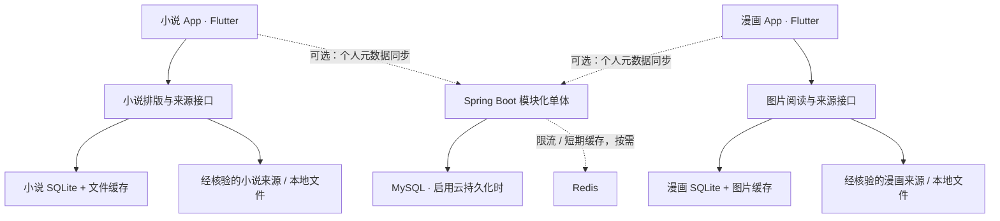

# 架构设计

状态：目标架构；MAC-01已初始化小说四端宿主和reader_core最小标识；MAC-02已实现D1应用壳、纯Dart平台端口与任务生命周期。MAC-06已验证受控WKWebView、中文精确检索及原生TTS小样，见[三项研究验收](verifications/mac-06-2026-10-19.md)；MAC-03已接入后台SQLite、系统资料目录、托管样本与稳定位置，见[存储决策](decisions/0006-mac03-local-storage-and-anchors.md)；通用导入/完整阅读/其他原生适配/后端仍待实现，见[应用壳验收](verifications/mac-02-2026-10-16.md)。外部源/第三方项目都是候选，不代表已接入。

2026-10-16：自用开发采用[“地外文明”特殊区域策略](development-region-policy.md)，不指定现实地区、跳过地区专项核验，不以地区未知阻塞开发。来源自身访问资格与项目地区策略分开，后文现实地区/渠道字段供原始信息保存及将来发布使用，当前不增加地区门槛。

当前交付顺序为 macOS 小说先行；[四端技术边界](novel-cross-platform.md)细化了平台端口、feature目录、稳定锚点和本地存储。本批不要求先部署共享后端或实现漫画；全局架构保持两 App、四端、Local-first 与可选模块化单体。

小说资源仅中文、免费优先；内置获准来源并允许导入。普通与18+源都属于完整首版，默认不调度18+源搜索，开关开启后才搜索。搜索开关独立于书架/隐私锁，关闭时保留成人收藏在独立分组且仍可按已有权限阅读；请求取消/迟到响应及混合源策略见 [来源规则](novel-source-policy.md)。

## 总体结构

内容默认由客户端读取有权访问的文件/来源，服务端同步个人元数据。授权方要求私密密钥、代理或内容交付时，另设计受控网关；不是默认把所有正文和图片经过 Spring Boot。

## 客户端边界

每款 App 使用 presentation → application → domain → infrastructure 的依赖方向。领域层不依赖 Flutter widget、HTTP 库或具体 SQLite 实现；阅读视图调用用例，通过 Repository/Source 抽象访问本地和网络。

| 目录 | 职责与依赖 |
|---|---|
| 小说/client | 独立 Flutter 工程（包名 novel_app）；书架/目录/文本阅读 UI、小说用例、四端入口；依赖共享包及 novel_sources |
| 漫画/client | 独立 Flutter 工程（包名 comic_app）；漫画书架/图片阅读 UI、漫画用例、四端入口；依赖共享包及 comic_sources |
| packages/reader_core | ID、语言、分级、分页/错误值；不包含文本排版或图片解码 |
| packages/reader_storage | 数据库接口、迁移基础、文件/缓存索引；两 App 分别创建库 |
| packages/reader_sync | 协议、待同步队列、重试、冲突处理，不包含来源凭据 |
| packages/reader_ui | 主题、基础交互与可访问性组件，不包含完整阅读引擎 |
| packages/platform_services | 文件权限/安全存储/语音/窗口/生命周期等端口与平台适配，首批验证macOS；不把平台插件泄露到领域层 |
| packages/novel_sources | BookSource、REST/OPDS/本地及规则适配器；独立于漫画适配器 |
| packages/comic_sources | ComicSource、REST/本地/规则与扩展边界；独立于小说适配器 |

尽量共享接口和基础能力，缓存策略、页面坐标、排版位置与数据库内容表分别拥有。状态管理库、HTTP/SQLite 库、EPUB 引擎、包工作区工具在 FND-01 的小样验证后决定。

仓库按产品目录组织，详见 [repository-layout.md](repository-layout.md)。每款 Flutter 工程共享 lib/，android/、ios/、windows/、macos/ 只存平台适配与打包配置，待 FND-01 由实际工程初始化。目录中使用中文产品名，Dart 包名、Java 模块标识使用英文。

## 四端适配

| 平台 | 验证重点 |
|---|---|
| Android | 文件选择/权限、后台任务、下载中断、低内存、系统安全存储 |
| iOS | 沙盒文件导入、生命周期、后台下载约束、安全存储、签名/发行 |
| Windows | 窗口、键鼠/快捷键、文件路径/编码、缩放、系统安全存储 |
| macOS | 文件访问权限、窗口/键鼠、沙盒/签名、系统安全存储 |

基础工程规划全部四端；构建需要相应系统工具链，不能把 macOS 本机检查当作 Windows 验证。无真机、工具链或证书时，明确标为未验证。

## 本地数据与标识

每款 App 独立数据库：novel.sqlite、comic.sqlite（逻辑名称，实际目录由平台 API 获取）。元数据入 SQLite；TXT/EPUB、章节和图片作为文件，数据库记录 hash、大小、引用与状态。

以下为全局完整目标表草案；当前小说实际11表及schema v3以[本地存储协议](storage/novel-schema.md)为准，未实现outbox/sync_state等后续功能：

- library_items：app_kind、content_key、source_id、source_item_id、标题、语言、分级、许可记录引用。
- progress：chapter_id、position_kind、position_payload、content_revision、device_seq、server_revision。
- bookmarks：独立 bookmark_id、锚点、备注、修订与墓碑。
- source_configs：规则版本/hash、权限、域名、启用状态、核验记录；不保存明文凭据。
- downloads/download_parts：队列、状态、文件校验、大小、预期页数与重试信息。
- cache_entries：内容/账号范围/来源版本的缓存键、路径、hash、最后访问、expiry、offline_pinned。
- outbox/sync_state：本地操作 ID、设备序号、游标与重试状态；本地数据修改和 outbox 入队同事务。
- rating_overrides：用户主动分类、来源原始分级与证据；用户修改不能降低来源/地区强制门槛。

content_key：网络来源采用 app_kind + source_id + source_item_id；本地book_id独立随机生成，用内容摘要/格式/解析版本检测文档重复和修订，不以摘要替代可持续书籍身份。不同来源版本/译本不自动认定同一本书；跨源对应由显式映射维护。

小说位置：TXT 内容偏移/段落锚点，EPUB 采用引擎可稳定恢复的 CFI 或 spine+片段位置；保存修订与上下文。不云同步排版页号。
漫画位置：chapter_id + 稳定 page_id/索引 + 页内比例 + 阅读方向；页面清单变化时先匹配 page_id，再使用可解释回退。

## 阅读与缓存

小说：大文件增量解码/索引，分页在可控窗口内计算；字体改变后重排并恢复内容锚点。EPUB/HTML 限制资源访问，净化脚本与危险 URL，不默认读取远程资源。

漫画：当前页优先 → 邻页动态预加载 → 有界内存缓存 → 磁盘缓存。聊天中的“预加载 2～5 页”是候选起点，不是固定参数；依据内存、图尺寸与滚动方向调整。按展示尺寸解码、长图分块、快速跳章取消过时工作，双页布局不改变原始页 ID。

下载状态：queued → fetching → verifying → ready；另有 paused/failed/cancelled。写入临时文件、校验后原子替换；未完成不得标为离线可读。只有服务端支持范围请求且 ETag/版本一致才续传，否则重新下载。

缓存键包含来源、内容版本、资源 ID 与账号范围；不要以含 Token 的整条 URL 当日志或公共 key。来源许可可禁止缓存/限制有效期；过期签名地址需重新获取。LRU 清理普通缓存，不淘汰用户固定离线文件；用户可单独清除下载。内存、磁盘和并发上限均可配置。

## 共享后端：模块化单体

单一 Spring Boot 进程/构建产物/部署，不把以下模块当作微服务：

| 模块 | 拥有职责 |
|---|---|
| reader-common | 最小通用值、错误/分页；禁止变成共享业务仓库 |
| reader-auth | 账号认证、Token、设备会话 |
| reader-user | 用户偏好、设备管理、删除流程 |
| reader-sync | 操作幂等、游标、冲突协议，调用小说/漫画领域接口 |
| reader-source | 来源目录、核验记录、非敏感配置版本；不执行任意第三方代码 |
| reader-novel（小说/server） | 小说书架、书签、进度聚合 |
| reader-comic（漫画/server） | 漫画收藏、书签、进度聚合 |
| reader-policy | 内容分级、年龄/地区/渠道资格判定 |
| reader-admin | 后期核验/审计入口，不列入本地 MVP |
| app | 唯一启动入口与模块装配 |

模块通过公开接口或内部事件协作，不直接跨模块改表。服务端共享库以 account_id、app_kind、device_id 隔离；小说/漫画内容表分别管理。后端不拥有用户本地下载状态的真实副本，只能同步下载偏好/清单，不能宣称另一设备已下载。

共享模块位于 services/reader_platform/modules，两个产品领域模块位于 小说/server 与 漫画/server。FND-01 选择构建工具后，用一个聚合构建声明这两处模块的实际路径；services/reader_platform/app 依赖并装配它们。目录分开不改变单体部署边界，不为手机端/PC 端分别复制服务器。

dev/test/prod 共用源码，配置/部署说明归入 infra/environments，真实密钥由运行环境注入。构建与发布按小说客户端、漫画客户端、共享服务分别执行，不使用不同源码副本表示环境。

本地阅读阶段完全不部署后端。启用云同步时 MySQL 持久化用户数据和变更日志；Redis 只在必要时做限流/短期缓存，故障不应丢失持久进度。版本、迁移工具和连接配置后续选择，不提供假定可运行的部署文件。

## 同步协议与冲突

接口草案见 [interfaces.md](interfaces.md)。采用每 App/账户游标的增量 pull、带 operation_id 的 push，服务端事务更新领域实体及变更日志。网络至少一次投递，通过唯一操作 ID 达到幂等，不声称网络 exactly-once。

- 服务器按修订顺序推进游标，不信任客户端时钟作为唯一排序。
- 设备操作有递增 device_seq，服务端拒绝过时的同设备操作；跨设备操作用 base_revision 检测并发。
- 进度向后跳读也是有效操作，不能简单取“最远页/章”；并发保留候选锚点，让用户选择，或按明确策略解析后记录。
- 书签以 bookmark_id 合并并保留删除墓碑；重试不生成重复书签，旧设备不能复活已删除条目。
- 游标失效/设备长期离线时采用快照恢复，并重放未确认 outbox；服务端仅确认成功持久化的操作。
- 内容未在另一设备下载时提示导入/获取，仍可显示同步锚点；不上传或自动分发作品。
- 未成年人/未知资格接收同步时也要过滤成人展示信息；不因另一设备开启成人模式而自动获得资格。

## 来源兼容与隔离

1. 首先实现统一接口、本地来源与静态自产 fixture。
2. REST/OPDS/基础规则支持按版本声明；Legado/异次元支持矩阵记录 HTML 提取、正则、分页、登录、JavaScript 等差异。
3. JSON 解析成功不等于规则执行兼容；默认禁用动态脚本。若引入脚本，先完成独立沙箱/能力许可、CPU/内存/时间/网络边界设计。
4. Mihon APK 不是 Dart 插件；不直接在 iOS/桌面执行。Suwayomi 可选外部桥接仅属研究，用户单独配置且受控；它不替代 Spring Boot 共享基础服务。
5. Kotatsu 仅作架构/适配参考候选，维护状态、JVM 运行条件及代码许可证待核验。
6. 服务端网络代理若确有需要，防 SSRF 包括 DNS/重定向各跳检查、私网/回环/元数据地址拒绝及响应大小限制。
7. 规则/扩展更新有签名或可信来源与 hash 记录；授权许可与代码执行信任是两个独立判断。

## 约束与发布

18+搜索默认关闭，保存原始分级。当前特殊区域跳过项目地区核验；App自身成年确认仅一份“我确认已经成年”声明，本机持久化，不设定期过期、不收集实名/生日/证件、不依赖后台或外部核验服务。声明、搜索偏好、隐私锁独立；来源登录/资格失效或用户清除声明时相应门禁生效，隐私锁解锁不重复成年声明。来源自身访问要求按正常流程处理；未来公开发行再处理相应专项，当前不声明任何商店核验已经通过。

未选择商业模式或项目源码许可证；Flutter/Dart与当前图标依赖已锁定，数据源与其他库仍按任务核验。将来规模需要服务拆分时，以数据/流量证据另写 ADR；现在不引入额外微服务设施。
