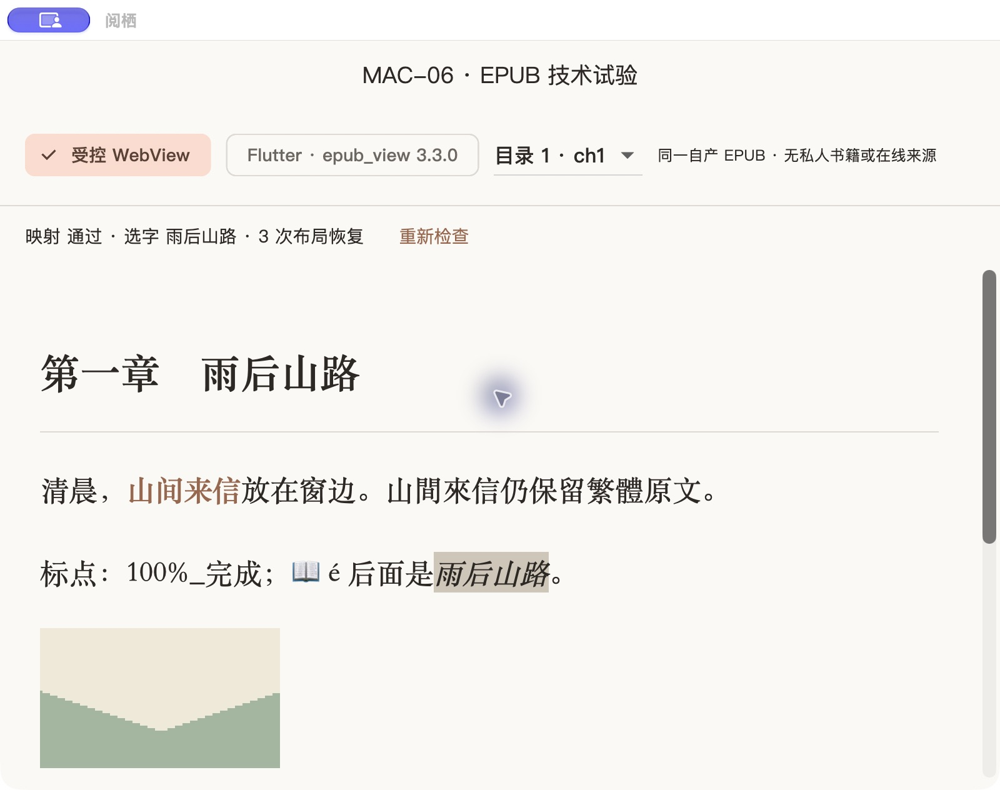

# MAC-06 / 第03步技术风险试验验收

日期：2026-10-19。结果：**研究任务已完成**；MAC-10/12只完成本步骤规定的前置试验，生产功能仍未开始。下一主任务是第04步MAC-03本地数据与位置协议。项目显示名“阅读软件”，小说App“阅栖”，D1确认版本和设计文件未修改。

## 交付与结论

| 方向 | 本批实跑结果与选择 | 证据 |
|---|---|---|
| EPUB | 同一自产EPUB在Flutter epub_view3.3.0与受控WKWebView中运行；选WK承载XHTML/CSS，Flutter保留D1壳。2章目录/内部链接、PNG/字体/外部CSS、真实中文选字、高亮、结构锚点、360宽与740宽双栏重排通过。Flutter库默认外部CSS/精确映射未通过；不推断所有Flutter排版均不可行 | [ADR-0003](../decisions/0003-mac06-epub-rendering.md)、[DOM与锚点原值](mac-06/webview.json)、[样本来源](../../fixtures/novel/mac06/README.md) |
| 中文检索 | Python SQLite3.53.4及系统SQLite3.54.0均实测unicode61/trigram；连续中文的单字短词不能只靠FTS MATCH。采用原文字面匹配为基线，短词扫描、长词trigram候选后核对；保留简繁/Unicode原文，转换SQL标量偏移到UTF-16 | [ADR-0004](../decisions/0004-mac06-chinese-search.md)、[11项查询及基准](mac-06/search.json)、[系统库9项核对](mac-06/search-native-sqlite.json) |
| 系统TTS | AVSpeechSynthesizer两条compact中文语音均产生非零PCM；暂停/继续及UTF-16范围回调通过，过期会话事件丢弃。静音实时运行600.33秒/147循环；进程采样峰值54336KiB，末次52224KiB | [ADR-0005](../decisions/0005-mac06-system-tts.md)、[状态/音频/范围](mac-06/tts-process-network-denied.json)、[RSS](mac-06/tts-memory.json) |

EPUB研究revision为原包SHA-256 `3d6d0a4ee10305897ef708f43e76375433998025b1417f0b655cb431090df701`。原包与Flutter输入逐字节相同；正文/PNG自产，嵌入字体为Phosphor MIT第三方资产，许可随样本保留。没有下载真实书源或成人正文。

## 验证方法和实际界面

独立Flutter入口为`小说/client/tool/mac06/probe.dart`，沿用同一个macOS宿主，通过AppKitView实际嵌入WKWebView；原生代码仅Debug编译。研究入口未接入默认`lib/main.dart`，不是在网页原型里模拟原生引擎。完整命令见[研究入口说明](../../小说/client/tool/mac06/README.md)。

真实鼠标点内部链接进入第二章，再选择“在这里”，桥接得到原文block `target` 的UTF-16 `[10,13)`；自动检查“目标位置”为`[6,10)`。固定host脚本在隔离world运行，page world另读脚本负例标志为false；净化测试同时确认书籍脚本被移除。https、file、跨书host、未列资源的负例被阻止。该结果只证明本样本/当前受限实现，不等于任意EPUB安全或规范符合性认证。

[Flutter库实际对照](mac-06/flutter-epub-view.jpg) · [第二章与选区](mac-06/webview-chapter2-selection.jpg) · [鼠标选中“在这里”](mac-06/webview-mouse-selection.jpg)

TTS探针进程通过sandbox-exec禁止网络；系统XPC语音服务没有被证明断网，因此**整机离线能力仍待MAC-12实测**。播放音量0且不改系统音量，没有听感/多音字/耳机路由结论。内存只采探针进程，不含语音服务或完整Flutter App。十分钟小样不代替整夜/休眠/锁屏验收。

## 自动检查和构建

在中文根目录运行`./tool/check.sh`通过：

- 21个Dart文件格式检查、严格Dart静态分析、两个共享包分析无错误；沿用ADR-0001的中文路径LSP替代方式。
- 19项Flutter/Dart测试：原15项保持，新增真实EPUB解析、UTF-16锚点往返、修订/块/摘录不符、非法范围/半代理对4项。
- 13项Python测试：净化与原文映射、ZIP路径/编码穿越/符号链接/重复、DTD/损坏XML/缺资源、加密元数据、重复ID/未知内容、外部CSS、展开预算、损坏ZIP。
- 中文查询准确性Python11项、系统SQLite9项均匹配原文字面基线；语料基准在忽略的build目录生成，不使用未知公网源完成测试。

Debug研究入口实际构建运行并完成界面试验。默认入口Release `0.0.3+3`构建成功，工具报告27.5MB；arm64可执行文件与AOT、最低部署目标12.0、ad-hoc deep/strict签名检查通过；已启动并确认D1空书架主界面，[启动截图](mac-06/release-shell.jpg)。最低系统12.0/Intel并未真机验证，其他三端未构建。

Release没有注册研究WK平台视图，探针标识在可执行文件/AOT中未检出，未增加network.client；实际沙盒与get-task-allow权限均为true，仍是内部ad-hoc产物，未公证、制作DMG或完成安装/升级。精确权限、NOTICES大小与哈希见[构建记录](mac-06/release-build.json)。研究样本资源随本次内部构建打包，不等于开放用户EPUB导入。

## 失败、修正及后续边界

1. epub_view传递解析到html0.15.7后首次编译失败（`qs.matches`缺失），保留[脱敏失败日志](mac-06/epub-view-initial-build-failure.log)。仅对已知样本精确锁html0.15.6后完成比较；旧版不作为生产不可信HTML解析选型。
2. 原Debug权限导致WebKit子进程退出；增加DebugProfile的network.client后本地资源代理运行。内容层CSP/导航/资源白名单仍限制外联，Release未扩权；正式MAC-07须验证生产权限。
3. 原生选区在Flutter按钮获焦后清空；监听selectionchange保存最后有效选区后，实际鼠标范围可回传。跨块/元素边界/ruby注音复杂选区、正式超时与进程恢复仍待MAC-07。
4. Swift5研究程序仍有Sendable提示；正式MAC-12须完成MainActor/回调线程隔离，不能直接搬作生产类。

MAC-03接下来定义正式schema/迁移、修订、文件索引和锚点回退，并复验实际Flutter SQLite绑定；MAC-07补正式Dart导入、大书预算、EPUB2/更多媒体和明确不支持报错；MAC-09/10/12补产品阅读、检索和听书闭环。MAC-06拒绝encryption.xml只是当前子集限制，不将标准字体混淆一概称为DRM。

本批没有生产数据库/文件授权、完整阅读器、正式TTS服务或在线接入。普通/18+内置批准仍0/0，MAC-18继续独立；地区项维持skipped_by_user。两款App、四端、可选后端范围保持。

依赖共49包：运行闭包11、研究专用29、其余开发9，版本/许可原文/哈希见[清单](../licenses/mac-06-dependencies.json)。项目源码许可证仍未选定。所有研究JSON只含自产文本与脱敏测量；构建、原始日志、数据库和机器路径保留在忽略目录。
